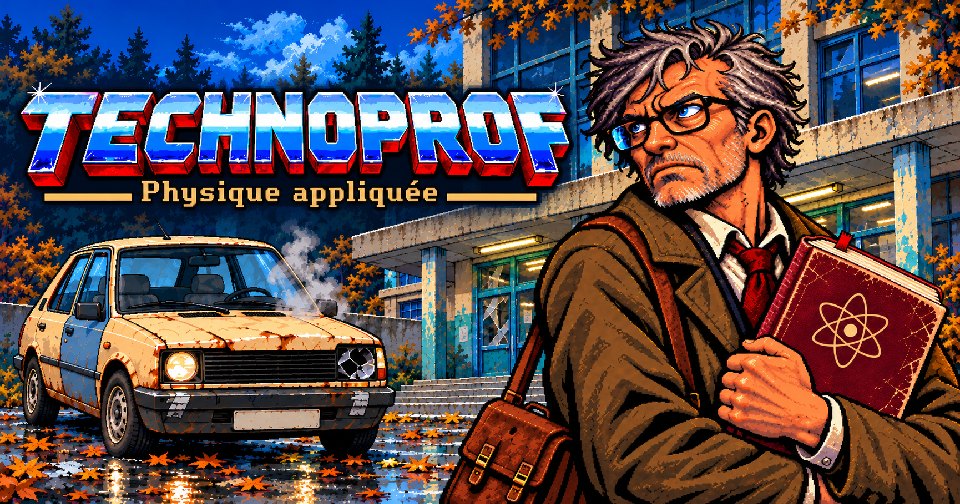
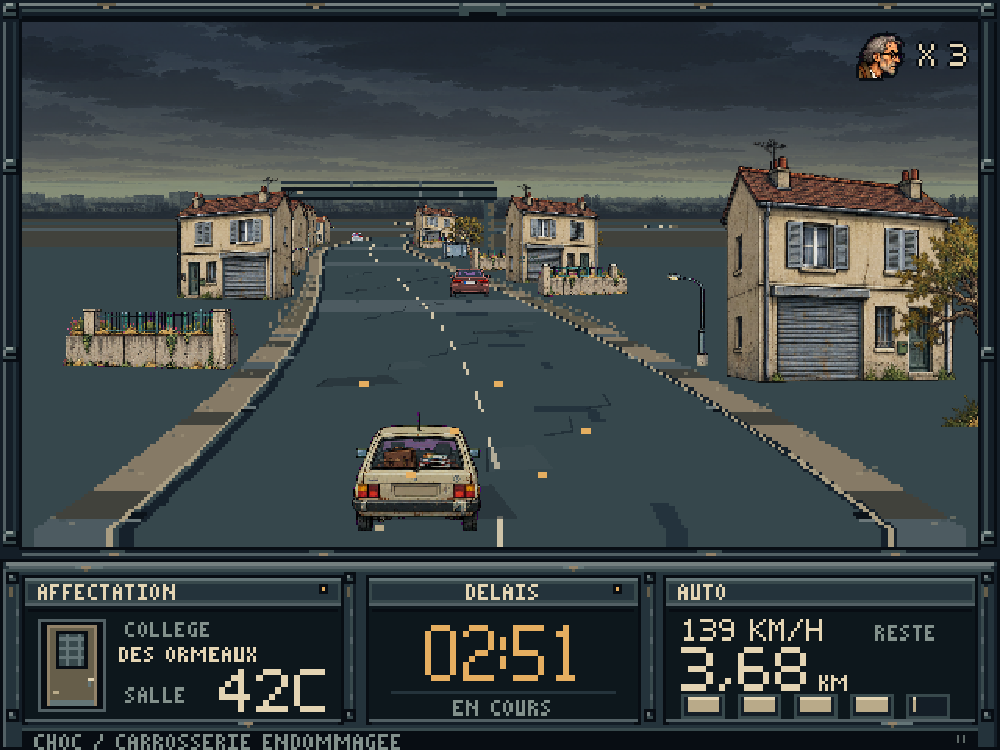
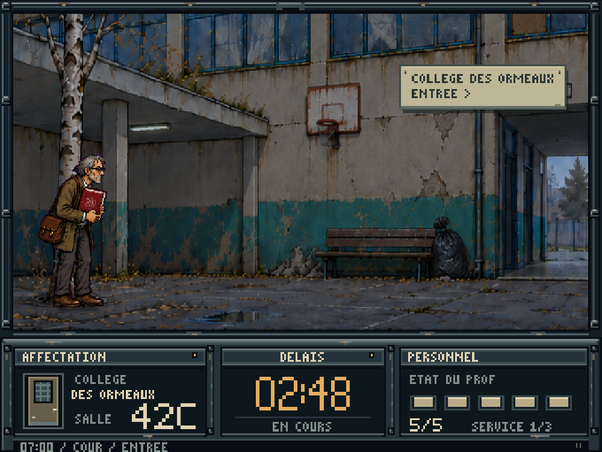

<p align="center">
  
</p>

# TECHNOPROF — Physique appliquée

<p align="center">
  <strong>Trois affectations. Une vieille voiture de service. Un manuel de physique.</strong>
</p>

<p align="center">
  <a href="https://kouboy.github.io/Technoprof/"><strong>▶ JOUER EN LIGNE</strong></a>
  &nbsp; · &nbsp;
  <a href="https://github.com/Kouboy/Technoprof/releases/latest/download/Technoprof-local.zip"><strong>⬇ TÉLÉCHARGER LE JEU</strong></a>
  &nbsp; · &nbsp;
  <a href="https://github.com/Kouboy/Technoprof/releases/latest">Notes de version</a>
</p>

**Vous êtes professeur remplaçant. Votre mission : arriver à temps pour faire cours.**
Au volant d’une voiture publique fatiguée, puis dans les couloirs d’établissements
à bout de moyens, chaque affectation devient une petite course d’obstacles.
Un même compte à rebours relie la route à la salle de classe.

TECHNOPROF est un jeu d’action rétro satirique français, inspiré de **Technocop** :
conduite en fausse 3D, exploration et combats de profil, pixel art comics pulp
et bande-son à samples low-fi dans l’esprit Amiga. Sous l’action, une école
qui tient encore grâce aux personnes qui y travaillent.

**Version de playtest** · Manette, clavier, souris et tactile · Trois vies pour réussir les trois affectations.

## En images

<table>
  <tr>
    <td width="50%"><a href="docs/presentation/conduite.png"></a></td>
    <td width="50%"><a href="docs/presentation/etablissement.png"></a></td>
  </tr>
  <tr>
    <td><strong>Sur la route</strong> — recevoir une affectation, gérer la circulation et gagner du temps.</td>
    <td><strong>Dans l’établissement</strong> — s’orienter, franchir les obstacles et rejoindre sa classe.</td>
  </tr>
</table>

*Captures du jeu jouable, sans retouche. Cliquer pour les agrandir.*

## Jouer

### Dans le navigateur

**[Ouvrir TECHNOPROF sur GitHub Pages](https://kouboy.github.io/Technoprof/)**,
puis choisir **Prendre le service**. Aucune installation ni compte nécessaire.
Sur téléphone, privilégier le paysage. Le son démarre après une première interaction.

### Sur PC, hors connexion

1. **[Télécharger le ZIP local](https://github.com/Kouboy/Technoprof/releases/latest/download/Technoprof-local.zip)** et extraire tout le dossier.
2. Sur Windows, lancer **Creer-raccourci.cmd**, puis le raccourci illustré **TECHNOPROF**. **Jouer.cmd** ouvre aussi directement le jeu.
3. Choisir **Prendre le service**. La fenêtre est redimensionnable et conserve le ratio 4:3.

Le lanceur Windows utilise Chrome s’il est installé. Pour un autre navigateur,
ouvrir **Jouer-Technoprof-Fenetre.html**, puis **Ouvrir le jeu dans sa fenêtre**.
Conserver le dossier **audio/** avec les fichiers du jeu.
Après déplacement du dossier, **Creer-raccourci.cmd** actualise le raccourci.

## Commandes

### Manette Xbox ou compatible

Appuyer sur un bouton pour activer la manette. Le stick gauche et la croix
directionnelle sont utilisables. Une déconnexion met la partie en pause.

| Action | En voiture | À pied |
|---|---|---|
| Se diriger | Stick gauche ou croix, gauche / droite | Stick gauche ou croix, gauche / droite |
| Accélérer | **RT** ou **A** | — |
| Freiner | **LT**, **B** ou **X** | — |
| Sauter | — | **A** |
| Frapper / avancer un dialogue | — | **B** ou **X** |
| Emprunter un passage | — | Direction indiquée près du passage |

**Start** : commencer au titre, pause / reprise en jeu, passer une cinématique.
Dans les menus : **A** pour valider, **B / X** pour revenir, directions pour naviguer.

### Clavier

| Action | Touches |
|---|---|
| Diriger / marcher | **← →** ou **Q D** |
| Accélérer / freiner | **↑ ↓** ou **Z S** |
| Emprunter un passage à pied | Direction indiquée : **flèches** ou **ZQSD** |
| Sauter | **Espace** |
| Frapper / avancer un dialogue | **F** ou **X** |
| Pause / reprise | **P** ou **Échap** |
| Couper / rétablir le son | **M** |

### Souris et tactile

Les commandes se font directement dans la scène, sans croix virtuelle ni boutons d’action superposés.

- **Conduite :** maintenir le clic ou le doigt et glisser latéralement pour diriger ; glisser vers le bas pour freiner.
- **À pied :** cliquer / toucher le sol pour marcher, un adversaire pour l’approcher et frapper, ou un passage pour l’emprunter.
- **Saut :** glisser vers le haut ; un geste en diagonale permet de sauter en avançant.
- **Dialogues :** cliquer / toucher pour afficher la réplique, puis avancer.

Le bouton **Pause** discret du CADRE donne accès à l’aide, au plein écran et aux réglages.
Quatre volumes séparés permettent d’ajuster musique, voix, effets et ambiance ; les secousses peuvent être réduites.

## Participer aux playtests

Les retours sur les sensations de conduite, la lisibilité des combats,
l’orientation et le rythme sont particulièrement utiles.

Après une session, **Pause / aide → Exporter mon essai** permet de sauvegarder
le journal JSON. Rien n’est envoyé automatiquement.
Le [questionnaire de retour](RETOURS-TEST.txt) aide à noter ses observations.
Pour signaler un problème : préciser le navigateur, le périphérique de jeu et le moment concerné
[dans les tickets du dépôt](https://github.com/Kouboy/Technoprof/issues).

---

## Le projet

Un projet de **Kouboy**, en développement et en phase de playtests.
La version jouable relie trois établissements : **Collège des Ormeaux**,
**Lycée Auguste-Berthelot** et **Lycée professionnel des Trois-Ponts**.

| Repère | Où le trouver |
|---|---|
| Jouable actuel et notes | [Dernière release](https://github.com/Kouboy/Technoprof/releases/latest) |
| Toutes les versions distribuées | [Releases](https://github.com/Kouboy/Technoprof/releases) |
| Historique des sources | [Commits](https://github.com/Kouboy/Technoprof/commits/main/) · [Historique importé](HISTORIQUE.md) |
| Documents de conception et d’atelier | [Documentation](docs/README.md) |
| Visuels de présentation et prompts | [Kit graphique](art/presentation-2026-10-28/README.md) |
| Optimisation, mesures et limites | [Rapport du 28 octobre](docs/technique/OPTIMISATION-PRESENTATION-2026-10-28.md) |

### Versions et identification des builds

GitHub Pages et le ZIP de chaque nouvelle release sont produits depuis le **même commit**.
Le commit servi en ligne figure dans [build-info.json](https://kouboy.github.io/Technoprof/build-info.json).
Dans le ZIP, **BUILD-INFO.json** liste la version et les empreintes des fichiers ;
**Technoprof-local.zip.sha256** permet de vérifier l’archive téléchargée.
Les anciennes releases, dont [v0.61](https://github.com/Kouboy/Technoprof/releases/tag/v0.61), restent disponibles.

### Construire depuis les sources

**Node.js 24 et npm** sont nécessaires. Le jeu utilise **TypeScript, Phaser et Vite**.

```sh
npm ci
npm run dev
```

| Commande | Résultat |
|---|---|
| `npm run build:pages` | Version web dans `dist/`, images et musiques séparées |
| `npm run build:journee` | Journée autonome : `Jouer-Technoprof-Journee-Atelier.html`, lanceur et icône Windows |
| `npm run build:atelier` | Atelier complet, journée jouable et raccourcis d’essai |
| `npm run package:local` | ZIP joueur et SHA-256 sous `work/checkpoints/release/` ; PowerShell 7 requis |
| `npm run test:playtest` | Vérification consolidée de la version de playtest |
| `npm run test:rapide` | Vérifications courantes pendant le développement |

Pour le jeu local, garder le dossier `audio/` à côté du HTML généré.
Les exports et dépendances ne sont pas conservés dans Git.
La [procédure de publication](docs/technique/PUBLICATION.md) décrit la livraison
Pages + ZIP et leurs contrôles.

### Organisation

- **src/** : gameplay, contrôles, rendu, son et données d’assets.
- **art/** et **audio/** : sources visuelles et sonores, maquettes et exports.
- **docs/** : conception, audits et documentation technique.
- **tools/** et **work/** : fabrication, validation et instrumentation.
- **archives/** : anciennes livraisons locales et manifestes.

© 2026 Brainrot Interactive Software
